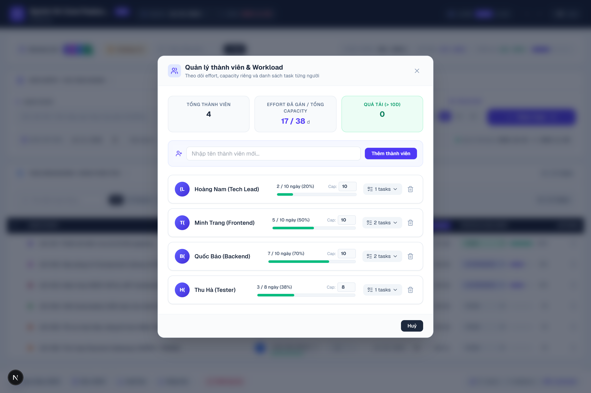
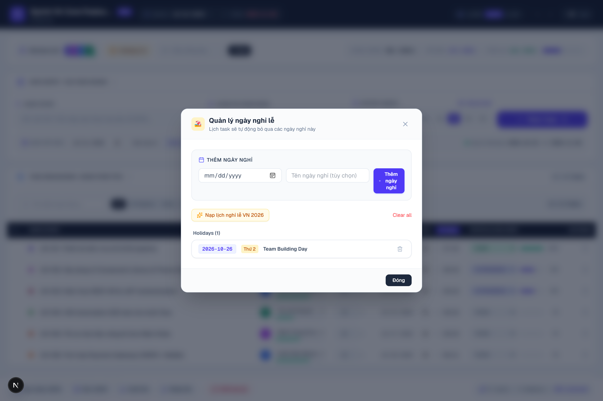
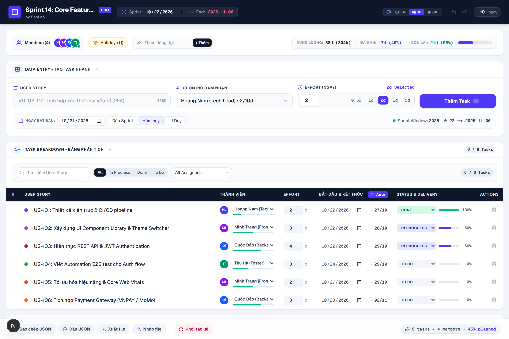

# 📊 Sprint Planner PRO — Agile Sprint & Gantt Chart Planning

> **Sprint Planner PRO** là ứng dụng quản lý và lập kế hoạch Sprint linh hoạt, tốc độ cao dành cho **Product Owner, Scrum Master, Tech Lead và Agile Team**. Ứng dụng giúp trực quan hóa khối lượng công việc (Workload), tự động tính toán tiến độ dự án, cân đối dung lượng (Capacity) và sinh biểu đồ **Gantt Timeline** tương tác trong thời gian thực.

---


---

## ✨ Tính Năng Nổi Bật

### 1. ⚡ Quản Lý Dung Lượng (Capacity) & Tính Toán Lịch Tự Động

- **Lập kế hoạch dung lượng chính xác:** Thiết lập tổng số ngày/giờ làm việc của Sprint (mặc định 10 ngày = 80h/thành viên hoặc tùy biến riêng cho từng người).
- **Tự động tính ngày kết thúc (End Date):** Tự động bỏ qua Thứ 7, Chủ Nhật và các ngày nghỉ lễ được định nghĩa trong hệ thống.
- **Cảnh báo thông minh:**
  - 🚨 **Quá tải (Overload):** Cảnh báo ngay khi một thành viên được gán số ngày vượt quá Capacity cá nhân.
  - ⚠️ **Tràn hạn (Spillover):** Đánh dấu cờ đỏ khi task vượt quá ngày kết thúc chính thức của Sprint.

### 2. 👥 Quản Lý Thành Viên Đội Ngũ & Phân Bổ Workload

- **Avatar Stack & Chỉ số sức tải:** Nhận diện ngay trạng thái công việc của từng đồng đội qua mã màu:
  - 🟢 Xanh lá: Còn trống dung lượng (Available).
  - 🟡 Vàng cam: Đã chạm ngưỡng dung lượng (At Capacity).
  - 🔴 Đỏ: Quá tải công việc (Overloaded).
- **Modal quản lý chuyên sâu:** Cho phép thêm/sửa/xóa thành viên, phân bổ lại task khi có người rời nhóm, và tùy chỉnh Capacity riêng cho từng vị trí (Intern, Part-time, Full-time).



### 3. 📅 Biểu Đồ Gantt Timeline Trực Quan & Tương Tác

- Hiển thị tiến độ làm việc từng ngày theo từng thành viên.
- Phân biệt rõ ngày làm việc, cuối tuần và các ngày nghỉ lễ chung.
- Đánh dấu mốc **Start Flag** và **Sprint End Flag**.
- 📸 **Xuất ảnh PNG 1-Click:** Chụp và xuất biểu đồ Gantt chất lượng cao để chèn vào báo cáo Sprint Review hoặc gửi khách hàng.


### 4. 🚀 Nhập Liệu & Sắp Xếp Công Việc Siêu Tốc

- **Tạo Task trong chớp mắt:** Điền tên User Story, chọn thành viên và nhấn `Enter` để lưu ngay.
- **Quick Effort Pills:** Chọn nhanh mức độ phức tạp phổ biến (0.5d, 1d, 2d, 3d, 5d).
- **Auto-Schedule Tuần Tự:** Tự động sắp xếp ngày bắt đầu các task của cùng một thành viên nối tiếp nhau, loại bỏ xung đột trùng lịch.

### 5. 🔍 Bộ Lọc & Tìm Kiếm Đa Chiều

- Tìm kiếm theo từ khóa User Story tức thời.
- Lọc theo thành viên phụ trách (Assignee).
- Lọc theo trạng thái thực thi (`TODO`, `IN_PROGRESS`, `DONE`).

### 6. 🏖️ Quản Lý Lịch Nghỉ Lễ (Holiday Calendar)

- Tùy chỉnh danh sách ngày nghỉ lễ của công ty hoặc quốc gia.
- Mọi thuật toán tính toán lịch trình và hiển thị Gantt chart tự động cập nhật và bỏ qua những ngày nghỉ này.



### 7. ↩️ Undo / Redo & Tự Động Lưu Trữ (Local Persistence)

- Phím tắt quen thuộc: `Ctrl + Z` (Hoàn tác) và `Ctrl + Y` (Làm lại).
- Tự động lưu toàn bộ trạng thái vào `localStorage` — không sợ mất dữ liệu khi vô tình tải lại trang.

### 8. 🌐 Hỗ Trợ Đa Ngôn Ngữ (i18n)

- Hỗ trợ đầy đủ **Tiếng Việt** và **English**.
- Chuyển đổi ngôn ngữ mượt mà thông qua `next-intl`.

---

## 📸 Hình Ảnh Toàn Bộ Dashboard



---

## 🛠️ Công Nghệ Sử Dụng (Tech Stack)

| Thành phần            | Công nghệ                    | Chi tiết                                                  |
| --------------------- | ---------------------------- | --------------------------------------------------------- |
| **Framework**         | Next.js 16 (App Router)      | Tận dụng React Server Components & Turbopack siêu tốc     |
| **Giao diện & UI**    | React 19, Tailwind CSS v4    | Thiết kế tối giản, hiện đại, hỗ trợ Dark Mode             |
| **Icons**             | Lucide React                 | Bộ icon SVG nhẹ và đồng bộ                                |
| **Quản lý State**     | Redux Toolkit & LocalStorage | Undo/Redo Engine với lịch sử thao tác nhiều bước          |
| **Data Fetching**     | TanStack React Query v5      | Quản lý cache và bất đồng bộ                              |
| **Đa ngôn ngữ**       | next-intl                    | Hỗ trợ localization Tiếng Việt (`vi`) và Tiếng Anh (`en`) |
| **Export Image**      | html-to-image                | Chụp DOM node thành ảnh PNG độ phân giải cao              |
| **Testing & Quality** | Jest, RTL, Playwright        | Đảm bảo tính ổn định và kiểm thử tự động E2E              |

---

## 🚀 Hướng Dẫn Cài Đặt & Chạy Ứng Dụng

### Yêu cầu tiên quyết

- **Node.js:** phiên bản `20.x` trở lên
- **Trình quản lý gói:** `npm`, `yarn`, hoặc `pnpm`

### 1. Clone repository & Cài đặt dependencies

```bash
git clone https://github.com/your-username/sprint-planner.git
cd sprint-planner

# Cài đặt gói thư viện
npm install
# hoặc
yarn install
```

### 2. Thiết lập biến môi trường (nếu có)

Sao chép file `.env.example` thành `.env.local`:

```bash
cp .env.example .env.local
```

### 3. Khởi chạy Development Server

```bash
npm run dev
# hoặc
yarn dev
```

Mở trình duyệt và truy cập:

- **Tiếng Việt:** [http://localhost:3000/vi](http://localhost:3000/vi)
- **English:** [http://localhost:3000/en](http://localhost:3000/en)

### 4. Build Production

```bash
npm run build
npm run start
```

### 5. Chạy Kiểm Thử (Testing)

```bash
# Chạy Unit Tests với Jest
npm run test

# Chạy E2E Tests với Playwright
npx playwright test

# Tự động chụp lại bộ ảnh Screenshots mới nhất
node scripts/take-screenshots.js
```

---

## 📂 Cấu Trúc Thư Mục (Project Structure)

```
TaskPlanning/
├── .ai/                      # AI Context, Quy chuẩn kiến trúc & bài học dự án
├── docs/
│   └── screenshots/          # Hình ảnh minh họa chất lượng cao cho README
├── messages/                 # Từ điển đa ngôn ngữ (en.json, vi.json)
├── public/
│   └── screenshots/          # Static assets phục vụ hiển thị web
├── scripts/
│   └── take-screenshots.js   # Script tự động hóa chụp ảnh màn hình bằng Playwright
├── src/
│   ├── app/                  # Next.js App Router ([locale], layout, api)
│   ├── components/
│   │   ├── common/           # Common wrappers (BrianButton, ErrorBoundary)
│   │   ├── ui/               # Base UI components
│   │   └── SprintPlanner/    # Core Modules (Gantt, Table, MemberModal, InputPanel)
│   ├── hooks/                # Custom hooks (useHistoryState, useDebounce...)
│   ├── services/             # Service layer cho API calls
│   ├── store/                # Redux Toolkit store, slices, providers
│   ├── types/                # TypeScript interfaces & types
│   └── utils/                # Date calculation & color helpers
├── package.json
└── README.md
```

---

## 💡 Gợi Ý Phát Triển Tiếp Theo (BA & Product Roadmap)

Dưới góc độ Business Analyst và quản lý sản phẩm, một số tính năng giá trị cao có thể tích hợp trong các bản cập nhật kế tiếp:

1. 🔄 **Export/Import Excel & CSV:** Cho phép import backlog từ file Excel hoặc Jira export vào Sprint Planner và ngược lại.
2. 🔗 **Đồng bộ với Jira / GitHub Issues / Trello:** Tích hợp webhook hoặc 2-way sync với Jira API để kéo User Stories về và đẩy timeline cập nhật lên.
3. 👥 **Real-time Collaboration (Multi-user):** Ứng dụng WebSocket (Supabase Realtime hoặc Liveblocks) để cả Scrum Master và Team Member cùng thao tác trong buổi Sprint Planning meeting.
4. 📈 **Burn-down Chart & Velocity Tracking:** Bổ sung biểu đồ Burn-down dựa trên trạng thái `DONE` thực tế qua từng ngày trong Sprint.

---

## 📝 Giấy Phép (License)

Dự án được phân phối dưới giấy phép **MIT License**.
